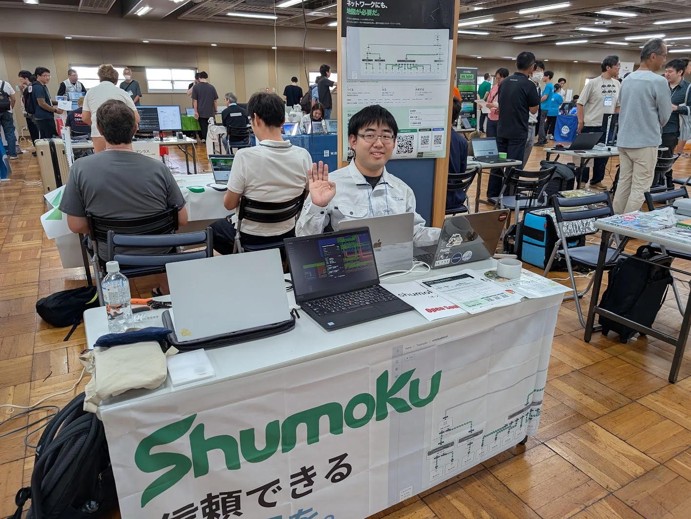
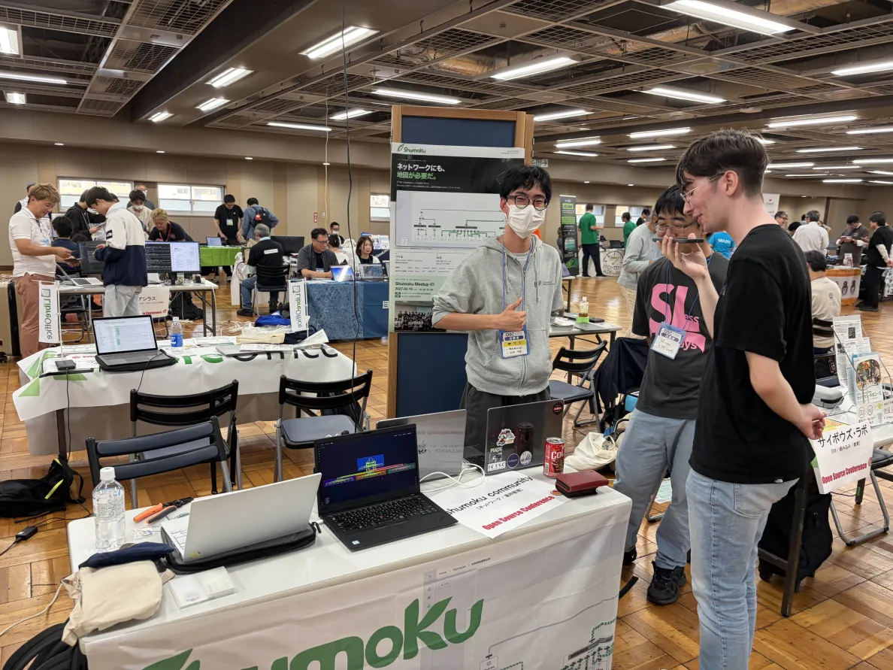
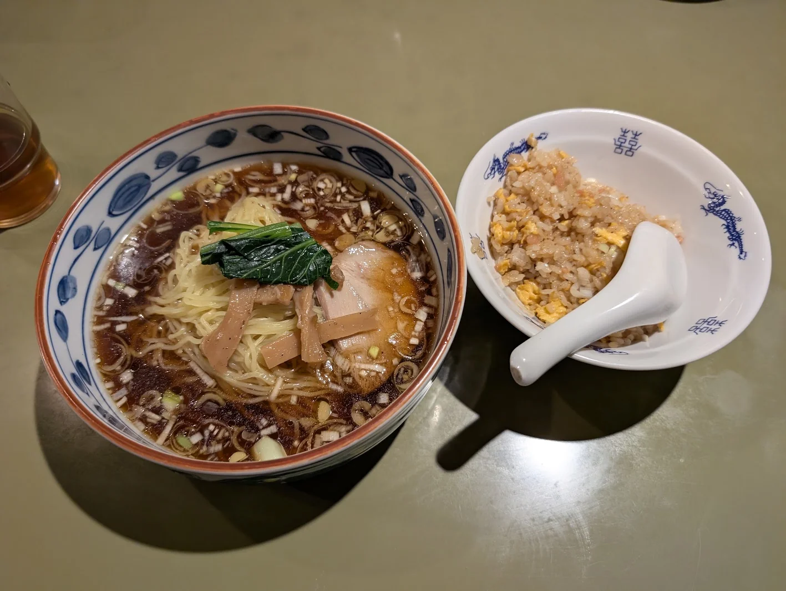

2026年10月17日、東京都立産業貿易センター 台東館で開催されたOSC Tokyo 2026 Fallに、Shumoku Communityとして出展しました。今回はakitoshiとvoidの2人で参加しました。

https://event.ospn.jp/osc2026-fall/

## 今回のブース

今回はakitoshiの体調不良もあり、実際の機材を使ったデモ環境の構築は見送り、デモページを使ったシンプルな展示にしました。

会場は開放感があり、広々と展示できました。前回の出展での教訓から発注した、机の前にかける布も無事に間に合いました。布があると、それっぽいブースになりますね！

配りたいと思っていた[Tech Tiles](https://github.com/tech-tiles/tech-tiles)は、残念ながら準備が間に合いませんでした。こちらは次回のイベント出展に向けて頑張ります！

[Tech Tiles](https://github.com/tech-tiles/tech-tiles)

いろいろな方がブースに立ち寄ってくださり、賑やかな出展になりました。

## LT「OSSって難しくない？？」

LTでは「OSSって難しくない？？」というタイトルで、Shumokuの紹介と、OSSとして開発を続けていく難しさについて話しました。

登壇後には、LTを聞いてくださった方とOSSという形態についてざっくばらんに話すことができました。発表をきっかけに意見を交わせたのが良かったです。

https://youtu.be/LD9rUmkCoRU?t=8410

## 出展を終えて

最後は近所の中華屋「中国料理 四川ハウス」で晩ごはんを食べて帰りました。ラーメンが美味しかったです。

ブースに立ち寄ってくださった皆さん、LTを聞いてくださった皆さん、ありがとうございました！
