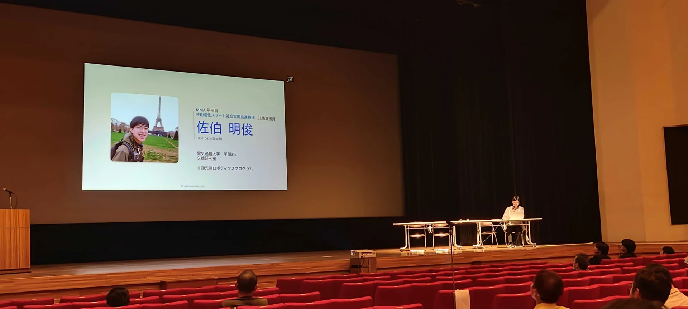
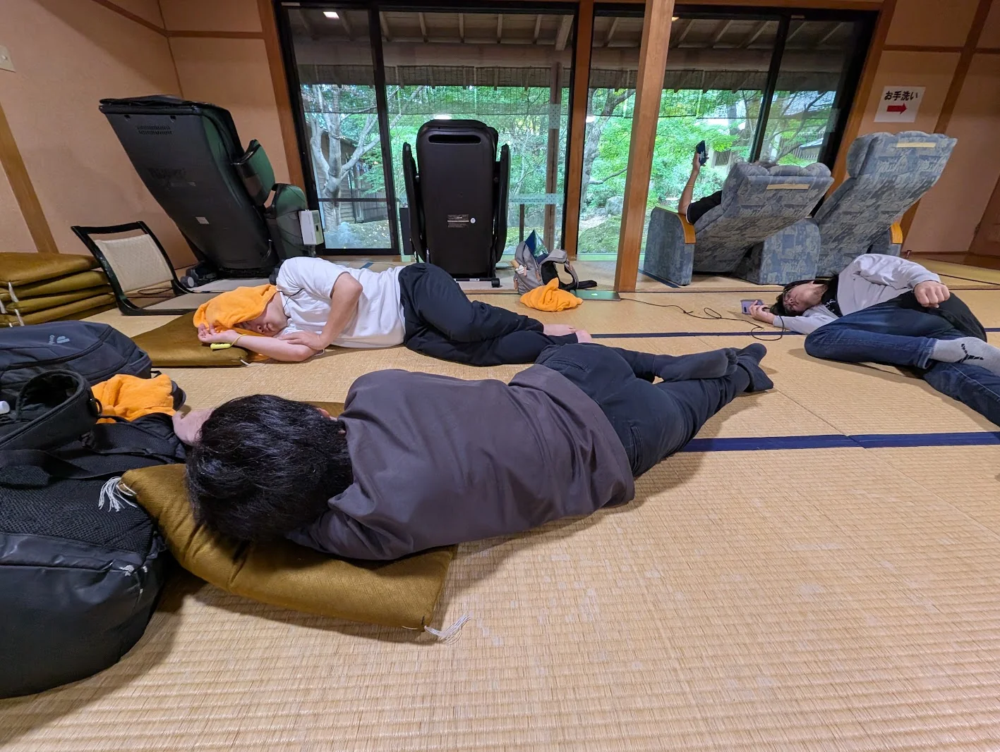
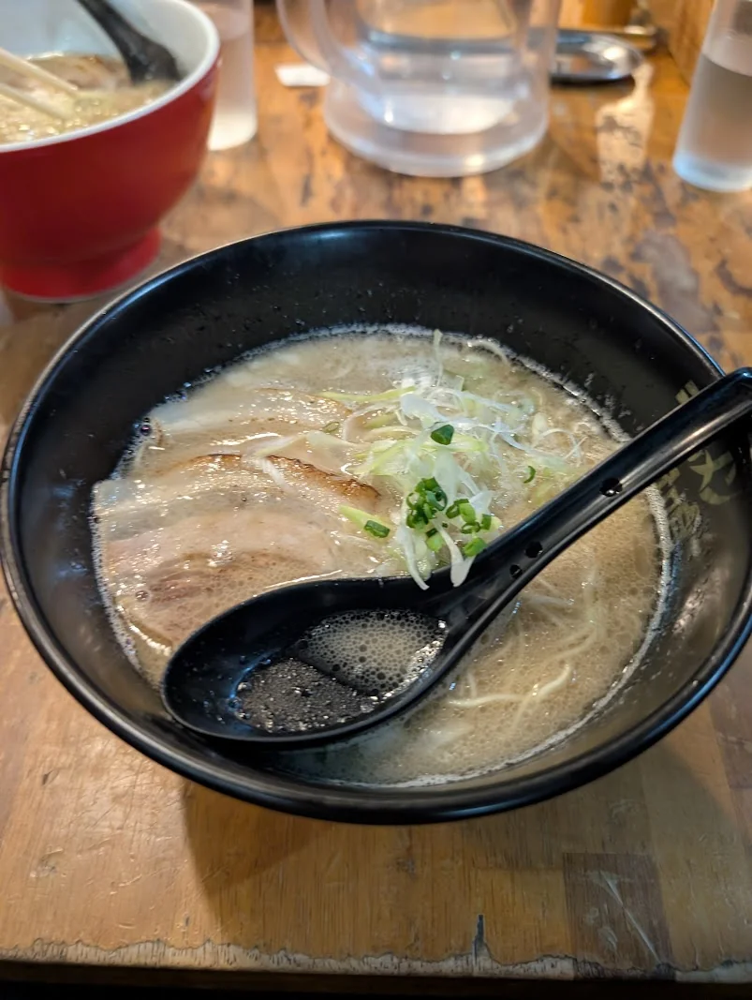

大分県宇佐市で開催されたQUNOG36に参加し、LTでShumokuを紹介してきました！

https://qunog.connpass.com/event/405652/

## 参加のきっかけ

JANOG58ではサーバーチームに参加していたのですが、チームのメンバーには九州の方が多く、それがきっかけでQUNOGにも参加してみました。

普段は東京に住んでいるので、九州の方々と直接会う機会はなかなかありません。せっかくなので、普段関わる機会の少ない方々と交流したいという気持ちもありました。

## LTでShumokuを紹介

QUNOGでは、Shumokuを紹介するLTをしました。JANOGには来ない方にも、Shumokuを知ってもらえたらという思いでの登壇です。

## 温泉と博多のごはん

イベント終了後は温泉へ。温泉地での開催ということもあり、しっかりリフレッシュできました。

その後は博多まで足を延ばし、もつ鍋とラーメンを食べて帰りました。

人と交流しつつ、体も温まるイベントになりました。
